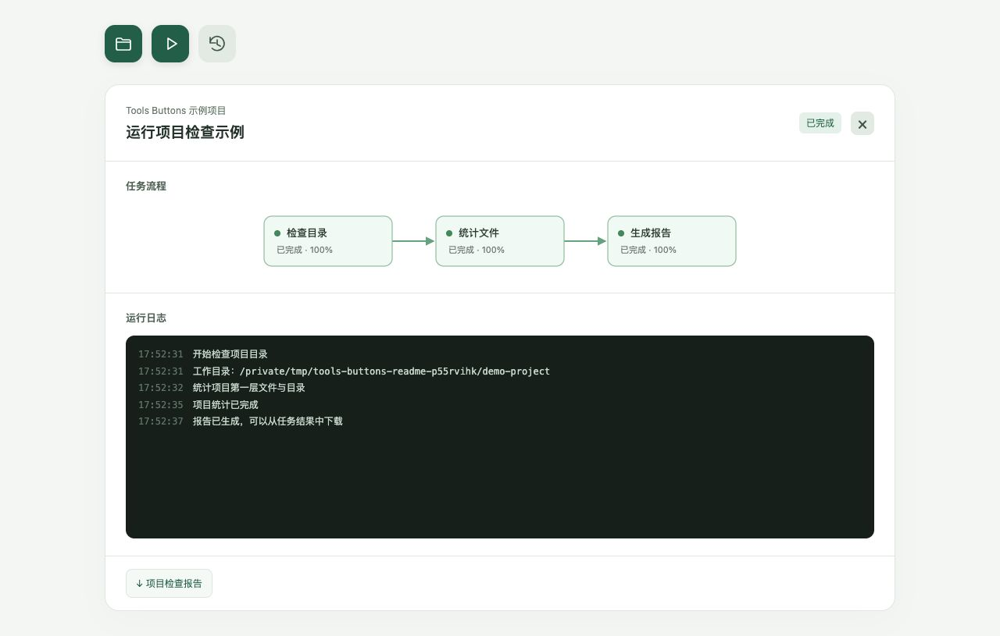
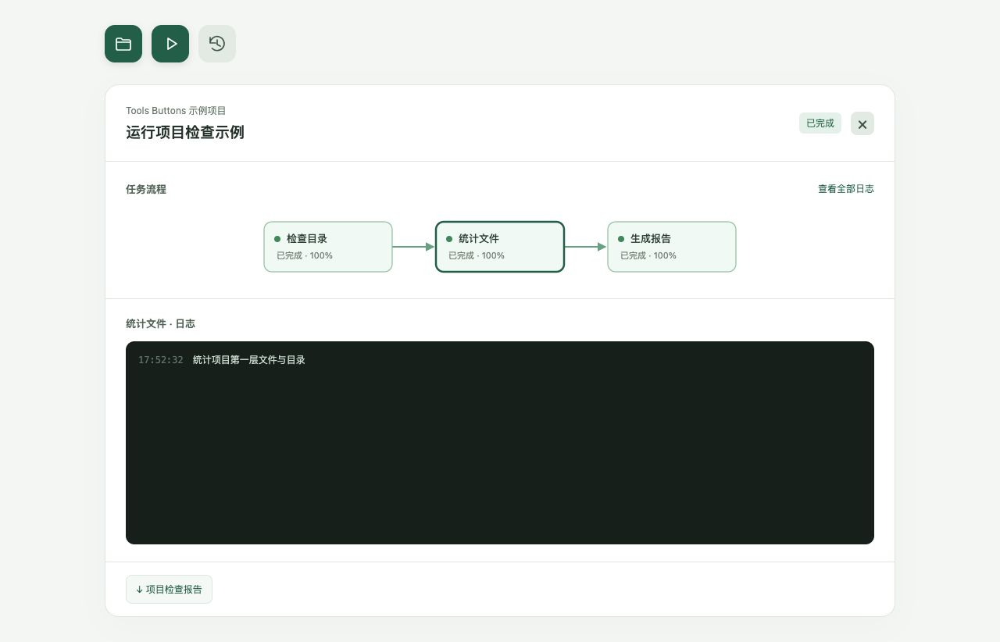
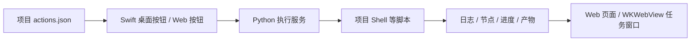

# Tools Buttons · 项目操作按钮

为项目增加可点击的操作按钮，把查看目录、部署、拉取日志、服务器备份等常用操作放到桌面上。
**JSON 定义按钮，Shell 等脚本实现功能，程序负责执行并展示日志、进度和任务流程。**

每个项目维护自己的配置和脚本，多个项目共用一份安装。AI 可以帮助编写配置和脚本；
配置完成后，点击按钮直接执行固定命令，无需再次调用模型分析。

## 能做什么

- **按项目配置**：不同项目拥有不同按钮、执行脚本、历史记录和产物。
- **桌面按钮**：macOS 原生悬浮图标，悬停显示说明，支持拖动和按项目记住位置。
- **显隐控制**：默认跟随 Codex 当前选择的关联项目，离开时隐藏、返回时恢复；菜单栏可手动控制。
- **两种界面**：桌面模式在应用任务窗口中显示详情；Web 模式在浏览器中展开同一套任务界面。
- **任务可见**：实时日志、节点状态、进度、按节点筛选日志、历史记录和报告下载。
- **直接接入脚本**：自动收集 stdout/stderr，也可主动上报结构化日志、节点、进度与产物。
- **便于 AI 维护**：接入时生成配置指南、JSON Schema、事件协议和 `AGENTS.md` 阅读入口。

部署和备份等业务由项目自己的脚本实现。程序使用当前用户的权限和环境执行命令。

## 界面预览

**macOS 原生桌面按钮与悬浮提示**。按钮是独立悬浮窗口，支持拖动；通过菜单栏控制显示和隐藏。


**一次真实的项目检查任务**：检查目录 → 统计文件 → 生成报告，展示完成状态、日志和报告下载入口。
下面两张截图来自 Web 模式；桌面任务窗口通过 WKWebView 使用同一套详情界面。



**点击节点筛选日志**：选中“统计文件”后，只展示通过 `pa_log --node count` 关联到该节点的日志。



## 快速开始

### 1. 首次安装并接入项目

在目标项目根目录打开终端，执行：

```bash
curl -fsSL https://raw.githubusercontent.com/foxhello-ai/tools-buttons/download/project-actions-macos.run | bash
```

单文件安装包约 **64 MB**，支持 **macOS 13+、Intel / Apple Silicon**，内置桌面应用、Python 运行环境、
执行服务和文档；使用者无需另外安装 Python、Swift 或 Xcode，也无需 sudo。

安装会初始化当前项目的 `.project-actions/`，向根目录 `AGENTS.md` 追加 AI 阅读入口，并启动桌面按钮。
已有配置、脚本和文档会保留。桌面按钮独立于 Codex 会话界面显示。

首次生成两个可直接点击的示例按钮：

| 按钮 | 悬浮说明 | 执行结果 |
| --- | --- | --- |
| 文件夹 | 查看当前目录 | 在任务日志中显示当前项目路径 |
| 播放 | 运行项目检查示例 | 检查目录、统计文件，显示三步流程并生成可下载报告 |

示例只读取项目文件，并在本项目的任务目录写入报告。

### 2. 同一台电脑接入其他项目

进入另一个项目根目录后执行，无需再次下载安装包：

```bash
~/.local/bin/project-actions add .
```

如果 `~/.local/bin` 已在 `PATH` 中，可以直接使用 `project-actions`。

### 3. 常用命令

```bash
~/.local/bin/project-actions add /path/to/project  # 初始化项目并启动桌面按钮
~/.local/bin/project-actions add . --no-launch     # 只初始化
~/.local/bin/project-actions open .                # 启动已接入项目的桌面按钮
~/.local/bin/project-actions validate .            # 验证 JSON 配置与流程图结构
~/.local/bin/project-actions web .                 # 使用浏览器模式
~/.local/bin/project-actions version               # 查看安装版本
```

macOS 默认在关联的 Codex 项目被选中时显示按钮。看不到时，可在菜单栏切换为始终显示，
并检查项目绑定。手动隐藏后需从菜单栏恢复；退出程序后，执行 `~/.local/bin/project-actions open .` 重新启动。
当前不会自动设置开机启动。

## 项目里会增加哪些文件

```text
your-project/
├── AGENTS.md                    # 追加 AI 阅读入口，保留原内容
└── .project-actions/
    ├── actions.json             # 按钮、命令、环境变量和流程节点
    ├── scripts/                 # 项目自己的 Shell 等业务脚本
    ├── AI_GUIDE.md              # AI 配置与脚本接入指南
    ├── AGENTS.md                # 目录级 AI 阅读入口
    ├── schema.json              # JSON 结构说明与编辑器补全
    ├── PROTOCOL.md              # 日志、节点、进度和产物事件协议
    ├── .gitignore               # 忽略本地运行数据
    ├── runs/<run-id>/           # 任务状态、完整日志与产物，自动生成
    └── .runtime*                # 本地服务发现等运行文件，自动生成
```

配置、脚本和文档可以随业务项目提交版本库；`runs/` 和 `.runtime*` 保留在本机。
桌面程序与运行环境安装在 `~/Library/Application Support/ProjectActions/`，多个项目共用。

## 使用实例：增加“查看目录并生成报告”按钮

下面是一组可以配套运行的 JSON 和 Shell。新测试项目可使用完整配置；已有项目应将新动作合并到
`actions` 数组，保留原有按钮和 `project.id`，并保持动作 ID 唯一。

### 1. 配置按钮

保存为 `.project-actions/actions.json`：

```json
{
  "$schema": "./schema.json",
  "version": 1,
  "project": {"id": "demo-project", "name": "示例项目"},
  "actions": [
    {
      "id": "inspect-project",
      "icon": "folder",
      "tooltip": "查看目录并生成报告",
      "command": ["bash", ".project-actions/scripts/inspect.sh"],
      "cwd": ".",
      "timeout": 60,
      "workflow": {
        "nodes": [
          {"id": "inspect", "label": "检查目录"},
          {"id": "list", "label": "列出文件", "dependsOn": ["inspect"]},
          {"id": "report", "label": "生成报告", "dependsOn": ["list"]}
        ]
      }
    }
  ]
}
```

`command` 是“可执行文件 + 参数”的数组，相对路径按 `cwd` 解析；`cwd: "."` 表示项目根目录。
管道、重定向和变量展开等 Shell 逻辑应写到脚本中。常用图标有 `folder`、`play`、`upload`、
`download`、`server`、`file`、`history`。

### 2. 编写 Shell

保存为 `.project-actions/scripts/inspect.sh`：

```bash
#!/usr/bin/env bash
set -Eeuo pipefail
source "${PROJECT_ACTIONS_SHELL:?请通过 Project Actions 启动此脚本}"

current_node=""
on_error() {
  local code=$?
  trap - ERR
  if [[ -n "$current_node" ]]; then
    pa_log error "执行失败，退出码：$code" --node "$current_node" || true
    pa_node "$current_node" failed || true
  fi
  exit "$code"
}
trap on_error ERR

current_node=inspect
pa_node inspect running
pa_log info "当前项目：$PROJECT_ACTIONS_PROJECT_DIR" --node inspect
test -d "$PROJECT_ACTIONS_PROJECT_DIR"
pa_node inspect succeeded

current_node=list
pa_node list running
pa_log info "开始读取目录" --node list
pa_progress list 0 1
ls -la "$PROJECT_ACTIONS_PROJECT_DIR"
pa_progress list 1 1 --message "目录读取完成"
pa_node list succeeded

current_node=report
pa_node report running
report_path="$PROJECT_ACTIONS_RUN_DIR/directory-report.txt"
printf '项目：%s\n' "$PROJECT_ACTIONS_PROJECT_DIR" > "$report_path"
ls -la "$PROJECT_ACTIONS_PROJECT_DIR" >> "$report_path"
pa_artifact "$report_path" --label "目录报告"
pa_log info "报告已生成" --node report
pa_node report succeeded
current_node=""
```

验证后打开按钮并点击运行：

```bash
~/.local/bin/project-actions validate .
bash -n .project-actions/scripts/inspect.sh
~/.local/bin/project-actions open .
```

配置约 3 秒自动刷新，下一次执行使用新配置；已运行的任务保留启动时的配置。
示例通过 `bash` 调用，无需给脚本添加可执行权限。

**流程图描述展示关系。** 实际执行顺序、并行、重试和失败处理由脚本控制，程序不会根据图自动调度命令。

## 给已有脚本添加日志、节点和进度

在通过按钮运行的脚本开头加载辅助函数：

```bash
source "${PROJECT_ACTIONS_SHELL:?请通过 Project Actions 启动此脚本}"
```

随后在实际业务步骤前后调用：

| 目的 | Shell 示例 | 界面效果 |
| --- | --- | --- |
| 记录日志 | `pa_log info "开始构建" --node build` | 日志关联到构建节点 |
| 开始步骤 | `pa_node build running --label "构建"` | 节点显示进行中；未定义的节点会动态创建 |
| 更新进度 | `pa_progress build 3 10 --message "完成第 3 项"` | 节点显示 30% |
| 完成步骤 | `pa_node build succeeded` | 节点显示成功 |
| 创建依赖 | `pa_node publish running --label "发布" --after build` | 将发布节点连接到构建节点 |
| 注册产物 | `pa_artifact "$PROJECT_ACTIONS_RUN_DIR/report.txt" --label "报告"` | 显示报告下载入口；文件需先生成 |

普通 stdout/stderr 也会自动进入日志；需要按节点筛选时使用 `pa_log --node`。
日志支持 `debug`、`info`、`warning`、`error`；记录 `error` 日志本身不会让任务失败，失败时应保留非零退出码
或上报失败节点。顺序步骤的错误处理可参考上面的完整脚本。

其他语言也可向工具注入的事件地址发送 JSON，字段和鉴权方式见 [事件协议](project-actions/PROTOCOL.md)。
脚本应通过按钮运行，以获得上报环境；在终端单独执行脚本不会自动获得这些变量。

### 可扩展的业务场景

| 场景 | 按钮对应的项目脚本 | 可展示的流程 |
| --- | --- | --- |
| 部署测试环境 | `deploy-staging.sh` | 检查配置 → 构建 → 上传 → 健康检查 |
| 拉取服务器日志 | `fetch-logs.sh` | 连接服务器 → 下载日志 → 生成压缩包 |
| 服务器备份 | `backup-server.sh` | 检查空间 → 导出数据 → 打包 → 校验 |

这些是接入方式示例，仓库不内置特定服务器的部署或备份逻辑。将现有业务命令写入自己的脚本，
为每个动作配置 `command`，再在真实步骤前后上报状态即可。

## 让 AI 帮你增加按钮

接入项目后，可以向项目里的 AI 提出这样的需求：

> 先读取 `.project-actions/AI_GUIDE.md` 和已有配置。为本项目增加“部署测试环境”按钮，
> 调用现有 `scripts/deploy-staging.sh`，保留其他按钮。为检查、构建、部署步骤添加节点、
> 日志和进度上报，并验证 JSON 与 Shell 语法。

初始化已在 `AGENTS.md` 中添加阅读入口，AI 可据此找到完整字段、示例和事件接口。
只调整按钮与业务脚本时，通常无需修改或重新编译桌面程序。

## 实现与平台支持



| 部分 | 实现 | 平台现状 |
| --- | --- | --- |
| 原生桌面 | Swift / AppKit，任务详情使用 WebKit | macOS 13+；发布包包含 Intel 与 Apple Silicon 架构 |
| 执行服务 | Python 标准库、子进程、HTTP、SSE 实时事件 | 发布包内置 Python；源码运行需要 Python 3.9+ |
| Web 界面 | HTML / CSS / 原生 JavaScript / SVG 流程图 | 现代浏览器，共用配置和任务服务 |
| 脚本接口 | Shell 辅助函数与 HTTP JSON 事件 | 业务脚本可用 Shell、Python 等语言编写 |

当前发布安装包仅面向 macOS。Linux / Windows 可复用执行服务与 Web 页面，并适配脚本；
原生桌面窗口需要对应平台的实现，尚未提供这两个平台的安装包或实机验证。
Intel 已实机验证，Apple Silicon 已交叉编译打包，尚未实机验证。

Codex 项目跟随通过读取其本地状态文件实现，适配的是内部格式；多窗口按全局最后选择的项目判断。
每个桌面实例关联一个项目。浏览器模式按启动目录读取配置，不控制浏览器窗口的自动显隐。

一个动作同一时刻运行一个任务，每个项目最多四个动作并行。任务支持超时和取消，停止时终止本机进程组；
远程任务的终止行为由远程脚本处理。关闭任务详情窗口不会停止任务。
完整日志保存在 `runs/<run-id>/events.jsonl`，界面显示最近 2000 条。

## 文档与源码

| 文档 / 目录 | 内容 |
| --- | --- |
| [AI 配置与脚本接入指南](project-actions/AI_GUIDE.md) | JSON 字段、完整示例、失败处理与验证步骤 |
| [事件协议](project-actions/PROTOCOL.md) | 日志、节点、进度、产物事件和 HTTP 接口 |
| [配置 Schema](project-actions/schema.json) | 配置结构与约束 |
| [共享执行器与 Web](project-actions/README.md) | 源码接入、任务记录与服务行为 |
| [原生桌面说明](directory-button-demo/README.md) | Swift 构建、拖动、显隐与 Codex 绑定 |
| [单文件安装与发布](project-actions/distribution/README.md) | 安装位置、更新、安装选项与打包 |

从源码构建桌面程序需要 macOS 13+、Xcode Command Line Tools 与 Python 3.9+。
在仓库根目录执行：

```bash
python3 -m unittest discover -s project-actions/tests -v
bash directory-button-demo/build-native.sh
python3 project-actions/distribution/build-release.py --version 0.1.0 --output-dir dist
python3 project-actions/distribution/verify-release.py dist/project-actions-macos.run
```

发布程序使用 ad hoc 签名，尚未提供 Developer ID 公证。构建和更新细节见单文件安装文档。
